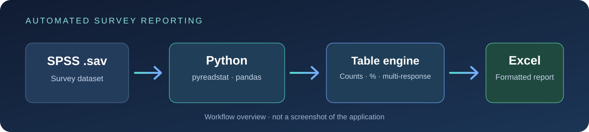

<!-- Profile README for github.com/heyzed001 -->

  

  <a href="https://www.linkedin.com/in/abdulaziz-shina-7200482b3/">LinkedIn</a> ·
  <a href="https://github.com/heyzed001">GitHub</a> ·
  <a href="mailto:kaybowel82@gmail.com">Email</a>

<h2>About me</h2>

I'm a **Data Forensics & Analytics professional** interested in building practical solutions around data, automation, and reliable data systems.

My work sits at the intersection of **data analysis, survey data processing, reporting automation, and data engineering**. I use Python to reduce repetitive work, SQL to work with structured data, and visualisation tools to make findings easier to understand and act on.

I enjoy taking a messy or repetitive workflow, understanding what is happening underneath, and turning it into something structured, reusable, and dependable.

<h2>What I work with</h2>

| Area | Tools and technologies |
|---|---|
| Programming & data processing | Python, pandas, NumPy |
| Databases & querying | SQL, relational databases |
| Analytics & reporting | Excel, Power BI, SPSS |
| Survey data | XLSForm, KoboToolbox, SurveyCTO |
| Automation & reporting | Python scripting, openpyxl, pyreadstat |
| Cloud & data engineering | AWS Lambda, Amazon S3, Amazon RDS, EventBridge |
| Data integration | REST APIs, ETL pipelines, JSON |

  
  
  
  
  
  
  
  
  

<h2>Featured projects</h2>

<table>
  <tr>
    <td width="50%" valign="top">
      <h3>01 · Automated SPSS Reporting</h3>
      
<a href="https://github.com/heyzed001/Python-Script-For-Custom-Tables"><strong>Python Script for Custom Tables ↗</strong></a>

      

      
Reads SPSS <code>.sav</code> files and automates survey cross-tabulations and formatted Excel reporting. Supports counts, percentages, multi-response questions, recoding, category merging, and reusable table-generation logic.

      
<strong>Tools:</strong> Python · pandas · pyreadstat · openpyxl · SPSS

    </td>
    <td width="50%" valign="top">
      <h3>02 · AWS Weather ETL Pipeline</h3>
      
<a href="https://github.com/heyzed001/aws-weather-etl-pipeline"><strong>View the AWS project ↗</strong></a>

      
A scheduled, serverless pipeline that retrieves weather data for Lagos from the OpenWeather API every morning. EventBridge triggers Lambda; raw JSON is stored in S3, while processed records are loaded into RDS for historical SQL analysis.

      
<strong>Tools:</strong> Python · AWS Lambda · EventBridge · S3 · RDS · REST API · SQL

    </td>
  </tr>
</table>

<h3>AWS project snapshots</h3>

  
  

  
  

Actual AWS console screenshots from the project repository. Select an image to open its source.

<h2>Areas I'm growing in</h2>

- Building reliable ETL and ELT pipelines
- Data warehousing and database design
- Cloud-based data engineering with AWS
- Workflow automation and data quality
- Turning analytical processes into reusable tools

<h2>GitHub activity</h2>

  
  

  <picture>
    <source media="(prefers-color-scheme: dark)" srcset="https://raw.githubusercontent.com/heyzed001/heyzed001/output/github-contribution-grid-snake-dark.svg" />
    <source media="(prefers-color-scheme: light)" srcset="https://raw.githubusercontent.com/heyzed001/heyzed001/output/github-contribution-grid-snake.svg" />
    
  </picture>

---

  <i>Curious about data. Focused on making systems and workflows work better.</i>

