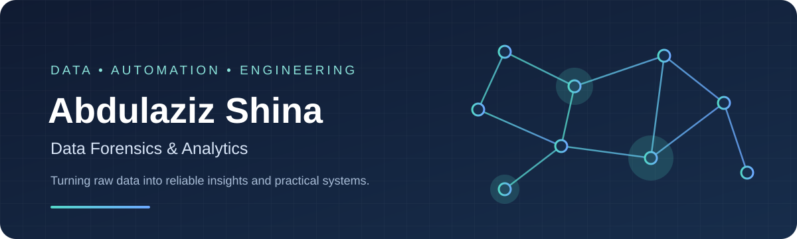

<!-- Profile README for github.com/heyzed001 -->

  

  <a href="https://www.linkedin.com/in/abdulaziz-shina-7200482b3/">LinkedIn</a> ·
  <a href="https://github.com/heyzed001">GitHub</a> ·
  <a href="mailto:kaybowel82@gmail.com">Email</a>

<h2>About me</h2>

I'm a **Data Forensics & Analytics professional** interested in building practical solutions around data, automation, and reliable data systems.

My work sits at the intersection of **data analysis, survey data processing, reporting automation, and data engineering**. I use Python to reduce repetitive work, SQL to work with structured data, and visualisation tools to make findings easier to understand and act on.

I enjoy taking a messy or repetitive workflow, understanding what is happening underneath, and turning it into something structured, reusable, and dependable.

<h2>What I work with</h2>

| Area | Tools and technologies |
|---|---|
| Programming & data processing | Python, pandas, NumPy |
| Databases & querying | SQL, relational databases |
| Analytics & reporting | Excel, Power BI, SPSS |
| Survey data | XLSForm, KoboToolbox, SurveyCTO |
| Automation & reporting | Python scripting, openpyxl, pyreadstat |
| Cloud & data engineering | AWS Lambda, Amazon S3, Amazon RDS, EventBridge |
| Data integration | REST APIs, ETL pipelines, JSON |

  
  
  
  
  
  
  
  
  

<h2>Featured projects</h2>

### 1. Automated SPSS Cross-Tabulation & Reporting

[**Python Script for Custom Tables**](https://github.com/heyzed001/Python-Script-For-Custom-Tables)

A Python reporting workflow that reads SPSS `.sav` files and generates formatted Excel tables. It supports counts, percentages, multi-response questions, recoding, category merging, and reusable table-generation logic.

**Tools:** Python · pandas · pyreadstat · openpyxl · SPSS

### 2. AWS Weather Data ETL Pipeline

[**AWS Weather ETL Pipeline**](https://github.com/heyzed001/aws-weather-etl-pipeline)

A scheduled, serverless pipeline that retrieves weather data for Lagos from the OpenWeather API every morning. Amazon EventBridge triggers an AWS Lambda function; raw JSON is stored in Amazon S3, while processed records are loaded into Amazon RDS for historical SQL analysis.

**Tools:** Python · AWS Lambda · EventBridge · S3 · RDS · REST API · SQL

<h2>Areas I'm growing in</h2>

- Building reliable ETL and ELT pipelines
- Data warehousing and database design
- Cloud-based data engineering with AWS
- Workflow automation and data quality
- Turning analytical processes into reusable tools

<h2>GitHub activity</h2>

  
  

---

  <i>Curious about data. Focused on making systems and workflows work better.</i>

